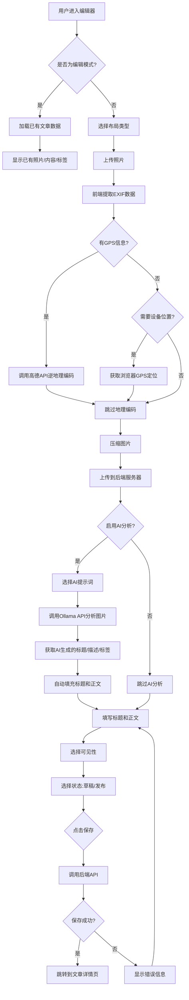
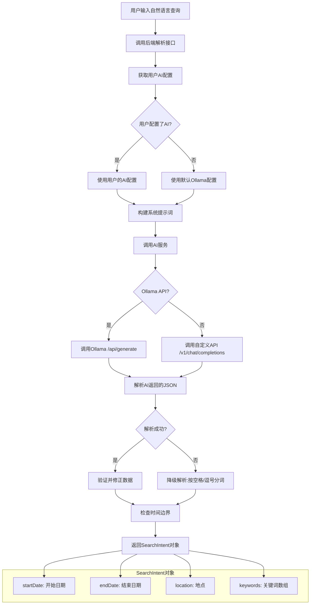
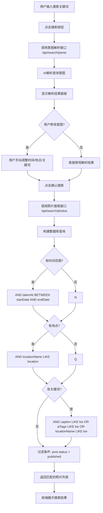

# 个人博客系统产品需求文档 (PRD)

## 1. 文档概述

### 1.1 项目背景
个人博客系统是一个功能丰富的现代化博客平台，专为个人用户设计，支持多媒体内容管理、AI智能分析、社交互动等功能。系统采用前后端分离架构，后端使用 Node.js + Express + TypeORM + MariaDB，前端使用 React + Vite + TypeScript + Tailwind CSS。

### 1.2 目标用户
- 个人博主、摄影师、旅行爱好者
- 技术开发者、内容创作者
- 希望拥有私有化部署博客的用户

### 1.3 核心价值
- **隐私优先**：完全私有化部署，数据自主掌控
- **AI赋能**：集成多种AI服务，提供智能图片分析和搜索
- **多端适配**：响应式设计，完美适配移动和桌面设备
- **社交互动**：关注系统、点赞评论，构建社区生态

---

## 2. 技术架构

### 2.1 技术栈

#### 后端
| 技术 | 用途 |
|------|------|
| Node.js | 运行时 |
| Express ^4.18 | Web框架 |
| TypeORM ^0.3 | ORM框架 |
| MariaDB 10.x | 关系型数据库 |
| JWT | 用户认证 |
| Multer | 文件上传 |

#### 前端
| 技术 | 用途 |
|------|------|
| React 18 | UI框架 |
| Vite ^5 | 构建工具 |
| TypeScript ^5 | 类型系统 |
| Tailwind CSS ^3 | 样式框架 |
| TanStack Query ^5 | 数据请求 |
| Zustand | 状态管理 |
| React 路由管理 |

 Router ^6 |#### AI服务
| 服务 | 用途 |
|------|------|
| Ollama (本地) | 图片理解与配文生成 |
| 通义千问 (可选) | 云端AI备选 |
| 文心一言 (可选) | 云端AI备选 |
| Moonshot (可选) | 云端AI备选 |
| 高德地图API | 地理编码 |

### 2.2 系统架构图

```
┌─────────────────────────────────────────────────────┐
│                    用户浏览器                         │
└──────────────────────┬──────────────────────────────┘
                       │
                Vite 开发服务器
                (localhost:5173)
                       │
              ┌────────┴────────┐
              │    前端 React    │
              │ React Router     │
              │ React Query     │
              │ Zustand         │
              └────────┬────────┘
                       │
              Express API
              (localhost:3000)
                       │
    ┌──────────────────┼──────────────────┐
    │                  │                  │
┌───┴───┐       ┌─────┴─────┐      ┌────┴────┐
│MariaDB│       │  本地文件系统 │      │ Ollama  │
│       │       │  (/uploads) │      │ AI服务   │
└───────┘       └────────────┘      └─────────┘
```

---

## 3. 数据模型

### 3.1 数据库表结构

#### 3.1.1 users - 用户表
| 字段 | 类型 | 说明 |
|------|------|------|
| id | UUID | 主键 |
| openid | VARCHAR(255) | 微信openid（唯一，可空） |
| unionid | VARCHAR(255) | 微信unionid（唯一，可空） |
| email | VARCHAR(255) | 邮箱（唯一，可空） |
| password | VARCHAR(255) | 密码（加密） |
| nickname | VARCHAR(100) | 昵称 |
| avatar | VARCHAR(255) | 头像URL（可空） |
| bio | TEXT | 个人简介（可空） |
| phone | VARCHAR(20) | 手机号（可空） |
| location | VARCHAR(100) | 地区（可空） |
| website | VARCHAR(255) | 个人网站（可空） |
| gender | VARCHAR(20) | 性别（可空） |
| birthday | DATE | 生日（可空） |
| display_time_preference | VARCHAR(36) | 时间显示偏好（createdAt/takenAt） |
| display_order_preference | VARCHAR(10) | 排序偏好（asc/desc） |
| ai_prompt_preset_id | VARCHAR(36) | AI提示词预设ID（可空） |
| role | VARCHAR(100) | 角色（user/editor/admin） |
| is_active | BOOLEAN | 是否激活 |
| ollama_base_url | VARCHAR(255) | Ollama地址（可空） |
| ollama_model | VARCHAR(100) | Ollama模型（可空） |
| custom_api_url | VARCHAR(255) | 自定义API地址（可空） |
| custom_api_model | VARCHAR(100) | 自定义API模型（可空） |
| ai_provider | VARCHAR(100) | AI提供商（ollama/custom） |
| created_at | DATETIME | 创建时间 |
| updated_at | DATETIME | 更新时间 |

#### 3.1.2 posts - 文章表
| 字段 | 类型 | 说明 |
|------|------|------|
| id | UUID | 主键 |
| user_id | VARCHAR(36) | 作者ID |
| title | VARCHAR(200) | 标题 |
| content | TEXT | 内容（可空） |
| layout_type | ENUM | 布局类型（timeline/grid/masonry/map） |
| status | ENUM | 状态（draft/published/archived） |
| visibility | ENUM | 可见性（public/friends/followers/private） |
| view_count | INT | 浏览次数 |
| like_count | INT | 点赞次数 |
| comment_count | INT | 评论次数 |
| created_at | DATETIME | 创建时间 |
| updated_at | DATETIME | 更新时间 |

**关联关系**：
- 多对一：User（一个用户多篇文章）
- 一对多：Photo（文章多张照片）
- 多对多：Tag（文章多标签）
- 一对多：Comment（文章多评论）
- 一对多：Like（文章多点赞）

#### 3.1.3 photos - 照片表
| 字段 | 类型 | 说明 |
|------|------|------|
| id | UUID | 主键 |
| post_id | VARCHAR(36) | 关联文章ID（可空） |
| url | VARCHAR(500) | 文件路径 |
| caption | TEXT | 配文（可空） |
| ai_title | VARCHAR(100) | AI标题（可空） |
| ai_confidence | FLOAT | AI置信度（可空） |
| ai_tags | JSON | AI标签数组（可空） |
| gps_lat | FLOAT | GPS纬度（可空） |
| gps_lng | FLOAT | GPS经度（可空） |
| gps_altitude | FLOAT | GPS海拔（可空） |
| gps_latitude_ref | VARCHAR(50) | 纬度参考（可空） |
| gps_longitude_ref | VARCHAR(50) | 经度参考（可空） |
| location_name | VARCHAR(255) | 位置名称（可空） |
| device_name | VARCHAR(255) | 设备名称（可空） |
| device_make | VARCHAR(255) | 设备制造商（可空） |
| device_model | VARCHAR(255) | 设备型号（可空） |
| software | VARCHAR(100) | 软件（可空） |
| image_width | INT | 图片宽度（可空） |
| image_height | INT | 图片高度（可空） |
| orientation | INT | 方向（可空） |
| taken_at | DATETIME | 拍摄时间（可空） |
| exposure_time | VARCHAR(50) | 快门时间（可空） |
| f_number | FLOAT | 光圈（可空） |
| iso_speed | INT | ISO（可空） |
| focal_length | FLOAT | 焦距（可空） |
| focal_length_35mm | INT | 等效焦距（可空） |
| flash | VARCHAR(50) | 闪光灯（可空） |
| white_balance | VARCHAR(50) | 白平衡（可空） |
| metering_mode | VARCHAR(50) | 测光模式（可空） |
| exposure_mode | VARCHAR(50) | 曝光模式（可空） |
| lens_model | VARCHAR(100) | 镜头型号（可空） |
| exif_data | TEXT | 原始EXIF数据（可空） |
| order | INT | 排序 |
| created_at | DATETIME | 创建时间 |
| updated_at | DATETIME | 更新时间 |

#### 3.1.4 comments - 评论表
| 字段 | 类型 | 说明 |
|------|------|------|
| id | UUID | 主键 |
| post_id | VARCHAR(36) | 文章ID |
| user_id | VARCHAR(36) | 评论者ID |
| parent_id | VARCHAR(36) | 父评论ID（可空，用于回复） |
| content | TEXT | 评论内容 |
| pinned | BOOLEAN | 是否置顶 |
| approved | BOOLEAN | 是否审核通过 |
| created_at | DATETIME | 创建时间 |
| updated_at | DATETIME | 更新时间 |

#### 3.1.5 likes - 点赞表
| 字段 | 类型 | 说明 |
|------|------|------|
| id | UUID | 主键 |
| post_id | VARCHAR(36) | 文章ID |
| user_id | VARCHAR(36) | 点赞者ID |
| created_at | DATETIME | 创建时间 |

#### 3.1.6 follows - 关注关系表
| 字段 | 类型 | 说明 |
|------|------|------|
| id | UUID | 主键 |
| follower_id | VARCHAR(36) | 关注者ID |
| following_id | VARCHAR(36) | 被关注者ID |
| created_at | DATETIME | 创建时间 |

**唯一索引**：(follower_id, following_id)

#### 3.1.7 tags - 标签表
| 字段 | 类型 | 说明 |
|------|------|------|
| id | UUID | 主键 |
| name | VARCHAR(50) | 标签名称（唯一） |
| slug | VARCHAR(50) | URL别名（唯一） |
| description | TEXT | 描述（可空） |
| post_count | INT | 文章数量 |
| created_at | DATETIME | 创建时间 |
| updated_at | DATETIME | 更新时间 |

#### 3.1.8 ai_prompt_presets - AI提示词预设表
| 字段 | 类型 | 说明 |
|------|------|------|
| id | UUID | 主键 |
| name | VARCHAR(255) | 预设名称 |
| type | VARCHAR(50) | 类型（image/search） |
| description | VARCHAR(500) | 描述（可空） |
| prompt | TEXT | 提示词内容 |
| user_id | VARCHAR(36) | 所属用户ID |
| is_default | BOOLEAN | 是否默认 |
| created_at | DATETIME | 创建时间 |
| updated_at | DATETIME | 更新时间 |

---

## 4. 业务逻辑

### 4.1 用户认证模块

#### 4.1.1 注册流程
1. 用户提交邮箱和密码
2. 后端验证邮箱格式和密码强度
3. 密码使用bcrypt加密存储
4. 创建用户记录，默认角色为user

#### 4.1.2 登录流程
1. 用户提交邮箱和密码
2. 后端验证凭证
3. 生成JWT Token（7天有效期）
4. 返回Token和用户信息

#### 4.1.3 权限控制
- **user**：浏览公开内容、点赞、评论、关注
- **editor**：user权限 + 创建/编辑/发布自己的文章
- **admin**：全部权限 + 用户管理 + 文章管理

### 4.2 文章管理模块

#### 4.2.1 创建文章



**详细步骤说明**：

1. **进入编辑器**：用户访问/editor创建新文章，或/editor/:id编辑已有文章
2. **加载数据**：编辑模式时，后端返回文章详情（含照片、标签，内容）
3. **上传照片**：
   - 前端通过DataView解析JPEG二进制提取EXIF信息、拍摄参数、GPS、设备等
4. **地理编码**：
   - 如照片有GPS，直接调用高德API获取中文地址
   - 如无GPS但需要，可获取浏览器定位
5. **图片压缩**：前端使用Canvas压缩图片（可选）
6. **后端存储**：照片保存到uploads/目录
7. **AI分析**（可选）：
   - 将图片转为Base64
   - 调用用户配置的Ollama API
   - 解析返回的JSON获取标题、描述、标签
8. **填写内容**：用户填写/修改标题、正文
9. **设置属性**：选择可见性（公开/好友/粉丝/私密）和状态（草稿/发布）
10. **保存提交**：调用POST /api/posts或PUT /api/posts/:id


**详细步骤说明**：

1. **进入编辑器**：用户访问/editor创建新文章，或/editor/:id编辑已有文章
2. **加载数据**：编辑模式时，后端返回文章详情（含照片、标签、内容）
3. **上传照片**：
   - 前端通过DataView解析JPEG二进制提取EXIF
  信息、拍摄参数、GPS - 支持设备等
4. **地理编码**：
   - 如照片有GPS，直接调用高德API获取中文地址
   - 如无GPS但需要，可获取浏览器定位
5. **图片压缩**：前端使用Canvas压缩图片（可选）
6. **后端存储**：照片保存到uploads/目录
7. **AI分析**（可选）：
   - 将图片转为Base64
   - 调用用户配置的Ollama API
   - 解析返回的JSON获取标题、描述、标签
8. **填写内容**：用户填写/修改标题、正文
9. **设置属性**：选择可见性（公开/好友/粉丝/私密）和状态（草稿/发布）
10. **保存提交**：调用POST /api/posts或PUT /api/posts/:id

```

#### 4.2.2 获取文章列表
```
输入：page, limit, status, tag, layout, sortBy, order, userId(可选)
处理：
1. 分页处理
2. 状态过滤（默认只返回published）
3. 布局过滤
4. 标签过滤
5. 可见性过滤：
   - 公开内容：所有人都可见
   - 好友可见：互相关注的用户
   - 关注者可见：作者的粉丝
   - 私有：仅作者本人
6. 排序支持：createdAt或takenAt，asc或desc
输出：分页后的文章列表
```

#### 4.2.3 可见性逻辑
```
IF 当前用户未登录：
    只返回 visibility = 'public' 的文章
ELSE：
    返回所有 visibility = 'public' 的文章
    + 自己发布的文章（不限可见性）
    + 好友（互关）发布的 visibility = 'friends' 的文章
    + 粉丝（单向关注）发布的 visibility = 'followers' 的文章
```

### 4.3 照片管理模块

#### 4.3.1 照片上传
```
输入：multipart/form-data（最多10个文件）
处理：
1. 验证文件类型（jpeg/jpg/png/gif/webp）
2. 限制文件大小（10MB）
3. 生成唯一文件名（UUID）
4. 存储到本地文件系统（uploads/目录）
5. 提取EXIF信息（如为JPEG）
6. 如有GPS信息，调用高德地图逆地理编码
7. 保存照片记录
输出：Photo对象数组
```

#### 4.3.2 EXIF提取（前端处理）
```
支持的EXIF字段：
- 设备信息：deviceMake, deviceModel, software
- 拍摄参数：exposureTime, fNumber, isoSpeed, focalLength, focalLength35mm
- GPS信息：gpsLat, gpsLng, gpsAltitude
- 拍摄时间：takenAt
- 其他：flash, whiteBalance, meteringMode, exposureMode, lensModel, imageWidth, imageHeight, orientation

解析方式：前端通过DataView手动解析JPEG二进制数据
```

#### 4.3.3 AI照片分析
```
输入：photoId, promptId(可选)
处理：
1. 获取照片URL
2. 将图片转换为Base64
3. 获取用户配置的提示词或默认提示词
4. 调用Ollama API进行分析
5. 解析返回的JSON结果
6. 更新照片记录（aiTitle, caption, aiTags, aiConfidence）
输出：分析结果
```

### 4.4 AI智能服务模块

#### 4.4.1 AI服务工厂
```typescript
// 支持的AI提供商
AI_PROVIDER=ollama    // 本地Ollama
AI_PROVIDER=tongyi   // 阿里通义千问
AI_PROVIDER=minimax  // MiniMax
AI_PROVIDER=moonshot // 月之暗面
AI_PROVIDER=mock     // 模拟（开发用）
```

#### 4.4.2 图片分析流程
```
用户上传照片 → 前端提取EXIF → 存储到服务器 → 
调用AI服务 → 解析JSON结果 → 更新照片记录
```

#### 4.4.3 搜索意图解析



**AI提示词示例**：
```
你是"时间"、"地点"、"关键词"拆分专家，当前2026-02-26。
地点指地图上的地点，如北京、上海、青岛等。

示例：
- 海边的日落 → {"startDate":null,"endDate":null,"location":null,"keywords":["海边的日落"]}
- 西藏的蓝天 → {"startDate":null,"endDate":null,"location":"西藏","keywords":["蓝天"]}
- 青岛 → {"startDate":null,"endDate":null,"location":"青岛","keywords":[]}
- 近三年青岛海滩 → {"startDate":"2023-02-26","endDate":"2026-02-26","location":"青岛","keywords":["海滩"]}
- 去年北京 → {"startDate":"2025-01-01","endDate":"2025-12-31","location":"北京","keywords":[]}
- 去年夏天上海 → {"startDate":"2025-06-01","endDate":"2025-08-31","location":"上海","keywords":[]}
- 五一期间的厦门 → {"startDate":null,"endDate":null,"location":"厦门","keywords":["五一"]}

请你深度思考解析，语句中不一定有全部的信息，只返回一个JSON。
```

#### 4.4.4 智能搜索流程



**数据库查询构建**：
```sql
SELECT photo.*, post.*
FROM photos photo
LEFT JOIN posts post ON photo.postId = post.id
WHERE photo.postId IS NOT NULL
  AND post.status = 'published'
  -- 时间范围
  AND (photo.takenAt BETWEEN :startDate AND :endDate)
  -- 地点
  AND (photo.locationName LIKE :location)
  -- 关键词 (caption/aiTags/locationName)
  AND (
    photo.caption LIKE :kw1 
    OR photo.aiTags LIKE :kw1 
    OR photo.locationName LIKE :kw1
  )
ORDER BY photo.takenAt DESC
LIMIT 100
```

### 4.5 关注系统模块

#### 4.5.1 关注/取消关注
```
关注：
1. 验证不能关注自己
2. 验证目标用户存在
3. 检查是否已关注
4. 创建关注记录
5. 判断是否成为好友（互相关注）

取消关注：
1. 删除关注记录
2. 更新好友状态为false
```

#### 4.5.2 关系查询
```
粉丝（followers）：followingId = 当前用户ID的关注者
关注（following）：followerId = 当前用户ID的关注
好友（friends）：互相关注的两个用户
```

### 4.6 地理编码服务

#### 4.6.1 逆地理编码
```
输入：GPS坐标（lat, lng）
处理：
1. 调用高德地图API
2. 解析返回的中文地址
3. 提取省、市、区、街道信息
输出：GeocodingResult对象
```

---

## 5. API接口规范

### 5.1 认证接口
| 方法 | 路径 | 描述 | 认证 |
|------|------|------|------|
| POST | /api/auth/register | 注册 | ❌ |
| POST | /api/auth/login | 登录 | ❌ |
| GET | /api/auth/profile | 获取个人资料 | ✅ |
| PUT | /api/auth/profile | 更新个人资料 | ✅ |
| PUT | /api/auth/settings | 更新设置 | ✅ |
| PUT | /api/auth/password | 修改密码 | ✅ |

### 5.2 文章接口
| 方法 | 路径 | 描述 | 认证 |
|------|------|------|------|
| GET | /api/posts | 获取文章列表 | ❌ |
| GET | /api/posts/all | 获取所有文章（管理员） | ✅ admin |
| GET | /api/posts/user/me | 获取我的文章 | ✅ |
| GET | /api/posts/:id | 获取文章详情 | ❌ |
| POST | /api/posts | 创建文章 | ✅ editor |
| PUT | /api/posts/:id | 更新文章 | ✅ editor |
| DELETE | /api/posts/:id | 删除文章 | ✅ editor |
| POST | /api/posts/:id/publish | 发布文章 | ✅ editor |
| PUT | /api/posts/:id/status | 修改文章状态 | ✅ admin |
| POST | /api/posts/:id/like | 点赞文章 | ✅ |
| GET | /api/posts/:id/liked | 检查是否点赞 | ✅ |

### 5.3 照片接口
| 方法 | 路径 | 描述 | 认证 |
|------|------|------|------|
| POST | /api/photos/upload | 上传照片 | ✅ |
| DELETE | /api/photos/:id | 删除照片 | ✅ |
| POST | /api/photos/:id/analyze | AI分析照片 | ✅ |
| PUT | /api/photos/:id/caption | 更新配文 | ✅ |
| PUT | /api/photos/:id/tags | 更新标签 | ✅ |
| GET | /api/photos/map | 获取地图照片 | ❌ |
| PUT | /api/photos/batch/exif | 批量更新EXIF | ✅ |

### 5.4 评论接口
| 方法 | 路径 | 描述 | 认证 |
|------|------|------|------|
| GET | /api/posts/:id/comments | 获取评论列表 | ❌ |
| POST | /api/posts/:id/comments | 添加评论 | ✅ |
| PUT | /api/comments/:id | 更新评论 | ✅ |
| DELETE | /api/comments/:id | 删除评论 | ✅ |
| POST | /api/comments/:id/pin | 置顶评论 | ✅ |
| POST | /api/comments/:id/approve | 审核评论 | ✅ |
| POST | /api/posts/:id/unapprove-all | 一键审核 | ✅ admin |

### 5.5 用户关系接口
| 方法 | 路径 | 描述 | 认证 |
|------|------|------|------|
| POST | /api/users/:id/follow | 关注用户 | ✅ |
| DELETE | /api/users/:id/follow | 取消关注 | ✅ |
| GET | /api/users/:id/followers | 获取粉丝 | ✅ |
| GET | /api/users/:id/following | 获取关注 | ✅ |
| GET | /api/users/:id/friends | 获取好友 | ✅ |
| GET | /api/users/:id/follow-status | 获取关注状态 | ✅ |
| GET | /api/users/:id/follow-counts | 获取关注统计 | ❌ |
| GET | /api/users/search | 搜索用户 | ✅ |

### 5.6 AI相关接口
| 方法 | 路径 | 描述 | 认证 |
|------|------|------|------|
| POST | /api/search/parse | 解析搜索意图 | ✅ |
| POST | /api/search/photos | 搜索照片 | ✅ |
| GET | /api/ai-prompt-presets | 获取提示词列表 | ❌ |
| POST | /api/ai-prompt-presets | 创建提示词 | ✅ |
| PUT | /api/ai-prompt-presets/:id | 更新提示词 | ✅ |
| DELETE | /api/ai-prompt-presets/:id | 删除提示词 | ✅ |
| POST | /api/ai-prompt-presets/:id/set-default | 设为默认 | ✅ |
| GET | /api/ai-config | 获取AI配置 | ✅ |
| PUT | /api/ai-config | 更新AI配置 | ✅ |
| GET | /api/ai-config/ollama/models | 获取Ollama模型 | ✅ |

### 5.7 标签接口
| 方法 | 路径 | 描述 | 认证 |
|------|------|------|------|
| GET | /api/tags | 获取标签列表 | ❌ |
| POST | /api/tags | 创建标签 | ✅ |
| PUT | /api/tags/:id | 更新标签 | ✅ |
| DELETE | /api/tags/:id | 删除标签 | ✅ |

### 5.8 管理接口
| 方法 | 路径 | 描述 | 认证 |
|------|------|------|------|
| GET | /api/users | 获取用户列表 | ✅ admin |
| PUT | /api/users/:id/role | 修改用户角色 | ✅ admin |
| PUT | /api/users/:id/status | 修改用户状态 | ✅ admin |

---

## 6. 功能模块

### 6.1 用户认证模块

#### 功能列表
| 功能 | 状态 |
|------|------|
| 邮箱注册登录 | ✅ |
| JWT认证 | ✅ |
| 登录限流 | ✅ |
| 微信登录 | ⚠️ 配置未完成 |
| 个人资料管理 | ✅ |
| 显示设置 | ✅ |

### 6.2 文章管理模块

#### 功能列表
| 功能 | 状态 |
|------|------|
| 创建/编辑/删除文章 | ✅ |
| 发布/下架文章 | ✅ |
| 文章可见性控制 | ✅ |
| 四种布局展示 | ✅ |
| 点赞/评论 | ✅ |
| 评论置顶/审核 | ✅ |

### 6.3 照片管理模块

#### 功能列表
| 功能 | 状态 |
|------|------|
| 批量上传 | ✅ |
| EXIF提取 | ✅ |
| AI图片分析 | ✅ |
| 地理编码 | ✅ |
| 照片管理 | ✅ |

### 6.4 首页展示模块

#### 功能列表
| 功能 | 状态 |
|------|------|
| 时间线布局 | ✅ |
| 网格布局 | ✅ |
| 瀑布流布局 | ✅ |
| 地图布局 | ⚠️ 基础功能 |
| 布局切换 | ✅ |
| TTS朗读 | ✅ |

### 6.5 社交功能模块

#### 功能列表
| 功能 | 状态 |
|------|------|
| 关注/取消关注 | ✅ |
| 粉丝/关注列表 | ✅ |
| 好友关系 | ✅ |
| 点赞文章 | ✅ |
| 评论文章 | ✅ |

---

## 7. 页面设计

### 7.1 页面列表
| 页面 | 路径 |
|------|------|
| 首页 | / |
| 登录 | /login |
| 注册 | /register |
| 写文章 | /editor |
| 编辑文章 | /editor/:id |
| 文章详情 | /post/:id |
| 用户中心 | /profile |
| 搜索 | /search |
| 帮助 | /help |
| API文档 | /api-docs |

---

## 8. 待完成功能

### 8.1 高优先级
- 文章照片关联优化
- 地图展示完善
- 评论审核机制

### 8.2 中优先级
- 微信登录
- 全文搜索
- RSS订阅

### 8.3 低优先级
- SEO优化
- 数据导出
- 多语言支持

---

## 9. 部署说明

### 9.1 环境要求
- Node.js >= 18
- MariaDB/MySQL >= 10.0

### 9.2 环境变量
```bash
# 数据库
DB_HOST=192.168.1.141
DB_PORT=3306
DB_USER=zhanglj
DB_PASSWORD=your_password
DB_NAME=personal_blog

# JWT
JWT_SECRET=your-secret-key

# AI服务
AI_PROVIDER=ollama
OLLAMA_BASE_URL=http://192.168.1.111:11434
OLLAMA_MODEL=openbmb/minicpm-v4.5:8b
```

---

## 10. 版本信息
- 文档版本：2.0
- 最后更新：2026-02-27