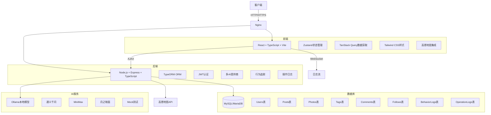
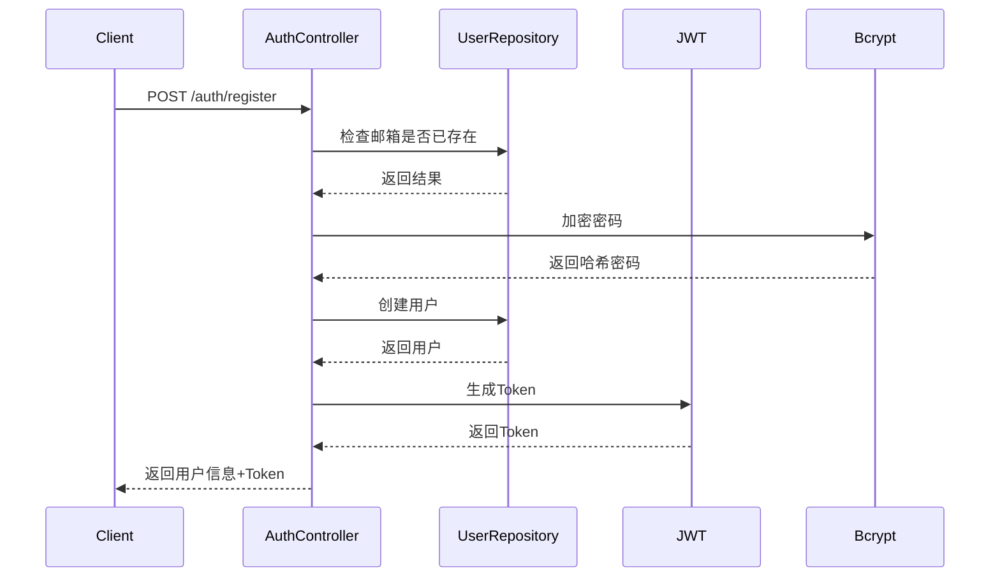
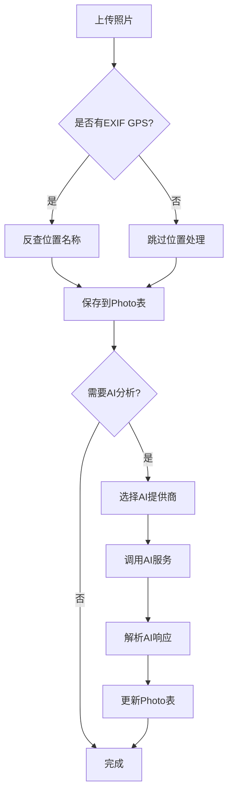
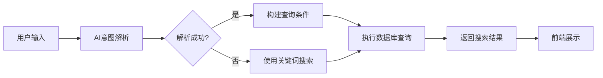
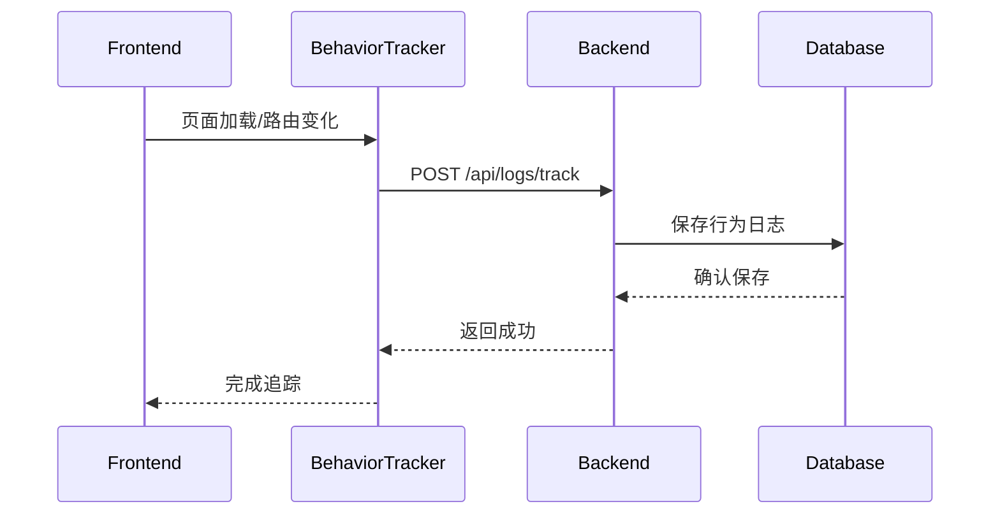

# 博客小时光系统 - 架构设计文档

## 1. 系统架构图

## 2. 技术栈详情

### 前端技术栈
- **框架**: React 18 + TypeScript
- **构建工具**: Vite
- **状态管理**: Zustand (轻量级)
- **数据获取**: TanStack Query v5
- **样式**: Tailwind CSS + React Icons
- **地图**: 高德地图 JavaScript API
- **路由**: React Router DOM v6
- **文件上传**: React Dropzone
- **Markdown**: React Markdown

### 后端技术栈
- **运行时**: Node.js + TypeScript
- **Web框架**: Express
- **ORM**: TypeORM
- **数据库**: MySQL/MariaDB
- **认证**: JWT + Bcrypt
- **验证**: Express Validator
- **文件上传**: Multer
- **缓存**: Node Cache
- **日志**: 自定义操作日志 + 行为日志
- **AI集成**: 多提供商适配器模式

### 部署架构
- **容器化**: Docker Compose
- **服务**: MariaDB + Backend + Frontend (Nginx)
- **网络**: 自定义 bridge 网络
- **卷**: 数据库持久化 + 上传文件持久化

## 3. 核心模块架构

### 3.1 用户认证模块

### 3.2 AI照片分析模块

### 3.3 语义搜索模块

### 3.4 行为追踪模块

## 4. 数据流设计

### 4.1 照片上传流程
1. 用户选择照片文件
2. 前端提取 EXIF 信息（包括 GPS）
3. 前端压缩图片并上传到 `/api/photos/upload`
4. 后端保存文件到 `uploads/` 目录
5. 后端保存照片元数据到数据库
6. （可选）后端调用 AI 服务分析照片内容
7. 返回照片信息给前端

### 4.2 文章发布流程
1. 用户在编辑器中创建文章
2. 用户可以选择已有照片或上传新照片
3. 提交文章到 `/api/posts`
4. 后端验证权限和数据
5. 保存文章到数据库
6. 关联照片到文章
7. 返回文章信息给前端

### 4.3 智能搜索流程
1. 用户输入自然语言搜索词
2. 前端发送到 `/api/search/parse`
3. 后端调用 AI 服务解析意图
4. AI 返回结构化查询条件（时间、地点、关键词）
5. 前端确认或修改查询条件
6. 发送最终查询到 `/api/search/photos`
7. 后端执行数据库查询
8. 返回搜索结果给前端

## 5. 安全架构

### 5.1 认证与授权
- **JWT Token**: 无状态认证
- **角色权限**: user/editor/admin 三级权限
- **中间件**: authenticate, authorize, isAdmin, isEditor
- **速率限制**: 登录/注册接口防暴力破解

### 5.2 数据安全
- **密码加密**: Bcrypt 哈希
- **CORS**: 严格限制来源
- **输入验证**: Express Validator
- **SQL 注入防护**: TypeORM 参数化查询

### 5.3 隐私保护
- **IP 过滤**: 排除本地和私有 IP
- **行为日志**: 可配置的隐私策略
- **数据可见性**: 文章支持 public/friends/followers/private 四级可见性

## 6. 扩展性设计

### 6.1 AI 服务扩展
- **适配器模式**: 统一接口，多种实现
- **配置驱动**: 用户可选择不同 AI 提供商
- **提示词模板**: 可自定义 AI 分析提示词

### 6.2 前端组件化
- **可复用组件**: LayoutSwitcher, MapView, PhotoCard 等
- **状态分离**: 不同功能使用独立的 Zustand Store
- **响应式设计**: 支持桌面/移动端

### 6.3 后端模块化
- **控制器分离**: 每个功能模块独立控制器
- **服务层**: 业务逻辑封装在 services 目录
- **中间件**: 可插拔的中间件系统

## 7. 性能优化

### 7.1 前端优化
- **懒加载**: 图片懒加载
- **虚拟滚动**: 长列表性能优化
- **缓存**: TanStack Query 缓存策略
- **代码分割**: 路由级别代码分割

### 7.2 后端优化
- **数据库索引**: 关键字段添加索引
- **查询优化**: TypeORM QueryBuilder 优化
- **缓存**: Node Cache 缓存热点数据
- **分页**: 所有列表接口支持分页

### 7.3 部署优化
- **容器化**: Docker Compose 一键部署
- **静态资源**: Nginx 直接提供静态文件
- **负载均衡**: 支持多实例部署
- **监控**: 内置健康检查接口

## 8. 监控与运维

### 8.1 健康检查
- **API**: `/api/health`
- **系统状态**: `/api/system/status`

### 8.2 日志系统
- **操作日志**: 用户关键操作记录
- **行为日志**: 用户浏览行为追踪
- **错误日志**: 统一错误处理中间件

### 8.3 管理界面
- **日志查看**: 管理员可查看操作日志
- **行为分析**: 用户行为统计
- **系统配置**: 运行时配置管理

---
*文档版本: 1.0*
*最后更新: 2026-03-03*